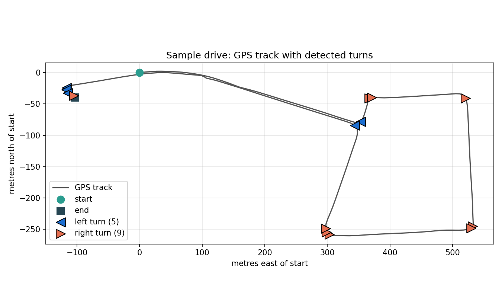

# Learn2Drive – driving-test practice assistant

[](https://github.com/YOUR_USERNAME/Learn2Drive/actions/workflows/tests.yml)


Final year project, BSc in Computer Science (Infrastructure), Technological University Dublin, 2025.

Learner drivers in Ireland often can't afford enough instructor hours before their test. Learn2Drive
turns a phone on the dashboard into a practice coach: an Android app records the road ahead, the
driver's face and the phone's GPS and accelerometer during a drive, uploads the session to a Python
server that scores it with OpenCV and MediaPipe, and then shows every turn and lane departure on a
map, colour-coded by how well the driver handled it.



*Turn detection running on the real sensor log in `sample_data/`. Regenerate with
`python tools/plot_sample_drive.py`.*

The full write-up is in [docs/Final_Year_Report.pdf](docs/Final_Year_Report.pdf) and the final
presentation in [docs/Final_Presentation.pptx](docs/Final_Presentation.pptx).

## What it detects

| Check | How | Shown in the app as |
|---|---|---|
| Turns | Compass bearing between consecutive GPS fixes, circularly smoothed; a change above 20° is a turn, detections within 1 s are merged | Marker at the turn |
| Mirror / observation checks | MediaPipe Face Mesh on the driver-facing video; counts head movements centre→left and centre→right in the 15 s around each turn | Green (looked both ways twice or more), orange (once each way), red (missed a side) |
| Lane departures | MobileNet-SSD finds the car behind in the rear-facing video; if it sits off-centre for 2 s or more outside a turn window, a departure is logged | Blue marker |

## Architecture

```
┌──────────────── Android app (Java) ────────────────┐      ┌──────────────── Server (Python) ────────────────┐
│ StreamingActivity                                  │      │ file_receiver.py  :5001                          │
│   • records front + rear camera (Camera2)          │ TCP  │   receives the three files, then runs            │
│   • logs accelerometer + GPS to sensor_data.csv    │─────▶│   run_pipeline.py:                               │
│   • uploads front_video.mp4, rear_video.mp4, csv   │      │   sensor_cleanup → turn_detection →              │
│                                                    │      │   lane_departure → mirror_checks →               │
│ TrackProgressActivity                              │ TCP  │   store_incidents ──▶ PostgreSQL                 │
│   • asks for GET_EVENTS, caches the JSON reply     │◀─────│ events_api.py  :9000                             │
│   • plots colour-coded markers on Google Maps      │      │   joins the tables and returns events as JSON    │
└────────────────────────────────────────────────────┘      └──────────────────────────────────────────────────┘
```

### Processing pipeline (`server/`)

| Step | Module | Input | Output |
|---|---|---|---|
| 1 | `sensor_cleanup.py` | `sensor_data.csv` | `gps_time_periods.csv` – one row per distinct GPS fix with its time span and average speed |
| 2 | `turn_detection.py` | `gps_time_periods.csv` | `detected_turns.csv` – time, direction and angle of each turn |
| 3 | `lane_departure.py` | `rear_video.mp4`, `detected_turns.csv` | `departure_events.csv` – times the car left its lane |
| 4 | `mirror_checks.py` | `front_video.mp4`, `detected_turns.csv` | `turn_transitions.csv` – left/right look counts per turn |
| 5 | `store_incidents.py` | the three CSVs above | PostgreSQL tables `detected_turns`, `departure_events`, `incidents` |

`run_pipeline.py` runs the steps in order on a session folder and stops at the first failure.
Each module also runs standalone, which is how they were developed and tuned.

The phone and server talk over a small custom TCP protocol rather than HTTP: the upload is
`writeUTF(filename)`, `writeLong(size)`, raw bytes; the event request is the line `GET_EVENTS`
answered with a 4-byte length prefix and a JSON array.

## Repository layout

```
server/        Python pipeline, TCP servers, MobileNet-SSD weights, PostgreSQL config, docker-compose.yaml
android/       Android Studio project (Java, Camera2, Google Maps SDK)
tests/         pytest unit tests for the pure-Python logic (run in CI on every push)
tools/         Helper scripts (README figure)
sample_data/   A real sensor log from a test drive so steps 1–2 can be run without a phone
database/      Earlier relational schema design from the interim stage (not used by the final pipeline)
docs/          Final report, presentation and figures
```

## Running the server

Requirements: Python 3.10+ and Docker.

```bash
pip install -r requirements.txt
cd server
docker compose up -d          # PostgreSQL 13 on localhost:5432, user Learner, db Incidents
python file_receiver.py       # terminal 1 – file receiver + pipeline runner
python events_api.py          # terminal 2 – event API for the app
```

Database credentials default to the ones in `server/docker-compose.yaml`; override them with the
`PG_HOST`, `PG_PORT`, `PG_DB`, `PG_USER` and `PG_PASSWORD` environment variables.

The video steps open OpenCV preview windows by default so you can watch the detections. Set
`SHOW_PREVIEW=0` to run headless.

### Trying the pipeline without a phone

Put a `sensor_data.csv`, `front_video.mp4` and `rear_video.mp4` from a drive into a folder and run:

```bash
python server/run_pipeline.py path/to/session --skip-db
```

The sample log in `sample_data/` lets you run the first two steps straight away:

```bash
cp sample_data/sensor_data.csv server/ && cd server
python sensor_cleanup.py && python turn_detection.py
```

The test-drive videos are not committed because they exceed GitHub's file size limit.

### Tests

```bash
pip install pytest
pytest
```

The tests cover bearing calculation, turn detection on synthetic GPS tracks, event merging, the
sensor-log segmentation, the TCP framing helper and the CSV loading in the database step. They run
on every push via GitHub Actions. The video-based steps are exercised manually with recorded drives.

## Building the app

1. Open `android/` in Android Studio (compile SDK 34, min SDK 27).
2. Create `android/local.properties` if it does not exist and add your Google Maps key:
   `MAPS_API_KEY=your_key_here`. The secrets-gradle-plugin injects it into the manifest at build time,
   so the key is never committed.
3. Set `SERVER_IP` in `StreamingActivity.java` and `SERVER_HOST` in `TrackProgressActivity.java` to
   the LAN address of the machine running the Python servers. The phone and server must be on the
   same network.
4. Run on a real device: the app records both cameras at once, which emulators do not support.

In the app: **Practice Driving** → *Start Recording* → drive → *Stop Recording* → *Process driving
behaviour* (uploads and triggers the pipeline) → **Track Progress** shows the map. The last successful
response is cached so the map still works offline.

## Engineering notes

Things that took real work to get right:

- **Aligning three data streams.** Video frames, accelerometer rows and GPS fixes arrive at
  different rates. Every sensor row is stamped with milliseconds since the front recorder started, so
  a turn found in GPS can be located in both videos and matched back to coordinates.
- **Circular smoothing of bearings.** A naive rolling mean of compass bearings treats 359° and 1° as
  180° apart. Bearings are smoothed as unit vectors (sin/cos) and converted back.
- **Per-turn baseline for head pose.** Rather than absolute thresholds, each turn segment calibrates
  "looking straight ahead" from its first 30 frames, which copes with the phone being mounted at
  slightly different angles on each drive.
- **Suppressing false lane departures.** The view behind changes completely during a turn, so lane
  checks are paused for a window around every detected turn.

## Known limitations and what I'd do differently

- **HTTP over custom TCP.** The hand-rolled framing works and was a good learning exercise, but a
  small Flask/FastAPI service would give retries, authentication and tooling for free.
- **Double-counted corners.** As the figure above shows, a slow or wide corner can trigger two
  detections a few seconds apart. Merging by distance as well as time would fix most of these.
- **Turn times are relative to the first moving GPS fix**, not the start of the video. If the car
  sits still at the start the turn times are early by that amount.
- **Thresholds are constants** tuned on one phone and one vehicle (20° turn angle, pixel offsets for
  head pose, 2 s departure window). They should be configuration, ideally calibrated per device.
- **Camera IDs are assumed** to be `1` (front) and `0` (rear); some devices order them differently.
- **Lane position is inferred from the following car**, so a departure can only be detected while
  there is a car behind. Lane-marking detection on the front camera would remove that dependency.
- **No authentication** on either TCP service; it is intended for a private LAN only.

## Tech stack

Java · Android Camera2 · Google Maps SDK · Python · pandas · NumPy · OpenCV (DNN module, MobileNet-SSD)
· MediaPipe Face Mesh · PostgreSQL · psycopg2 · Docker Compose · pytest · GitHub Actions

## License

MIT – see [LICENSE](LICENSE).
